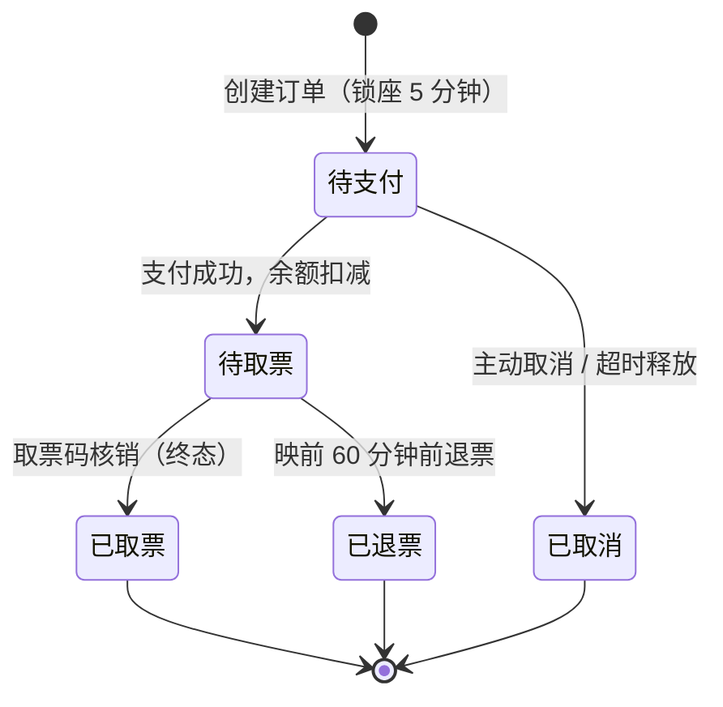
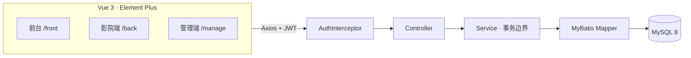

<div align="center">
  
  <p>
    <a href="https://github.com/renjianfeng8/Java_SpringBoot/actions/workflows/ci.yml"></a>
    
    
    
    
    
  </p>
  <p>
    <a href="#快速开始">快速开始</a> ·
    <a href="#功能一览">功能一览</a> ·
    <a href="#技术栈">技术栈</a> ·
    <a href="#质量保障">质量保障</a> ·
    <a href="项目索引.md">项目文档</a>
  </p>
</div>

## 项目简介

一个**前后端分离、三端协同**的电影购票平台：游客和用户在前台选片购票，影院在后台维护影厅与排片，平台管理员负责账号、影院审核、影片资料与资金流水。

项目不是 CRUD 演示：下单锁座、余额支付、取票码核销、退票回滚都在真实事务里完成，并针对**并发抢座、排片重叠、删除与下单竞争**做了锁与冲突处理。后端 555 条测试、前端 37 条单测、5 条 Playwright 冒烟，CI 全绿。

## 功能一览

| 前台（游客 / USER） | 影院端（CINEMA） | 管理端（ADMIN） |
| --- | --- | --- |
| 首页轮播、今日票房、热播 / 待映、票房与口碑榜 | 影厅管理 | 数据驾驶舱 |
| 影片筛选、详情、演职人员、影评与点赞 | 排片管理（防同厅时段重叠） | 账号管理、影院审核 |
| 影院列表、城市 / 区域筛选、按片选场 | 订单出票与取票核销 | 影片（TMDB 导入）、演员、类型、地区 |
| 可视化选座、余额支付、取票码 | 公告、个人资料、改密 | 影厅、排片、订单取消 / 退票 |
| 订单全流程：续付 / 取消 / 退票 / 取票 / 评价 | | 评价、充值审核、资金流水 |
| 账户充值、流水、余额走势、支付密码 | | 公告、预告片、影院名录（高德导入） |

**购票主链**：选片 → 选影院 → 选场次 → 选座 → 建单锁座 → 余额 + 支付密码支付 → 生成取票码 → 取票大厅核销。



## 技术栈

| 层 | 选型 |
| --- | --- |
| 后端 | Spring Boot 3.3.13 · Java 17 · MyBatis（XML Mapper）· PageHelper · jjwt · BCrypt |
| 数据库 | MySQL 8.0 · 18 张业务表 · 订单状态库级 `CHECK` |
| 前端 | Vue 3.5 · Vue Router 4.5 · Element Plus 2.9 · ECharts 6 · Vite 6 · Sass |
| 测试 | JUnit 5 + Mockito（后端）· Vitest（前端）· Playwright（E2E） |
| 工程 | GitHub Actions CI · ESLint · 统一响应 `Result<T>` · JWT + RBAC |

**分层**：`Controller 23 → Service 26 → Mapper 17 → MySQL`。通用 CRUD 由 `BaseController / BaseService / BaseMapper` 收敛，业务规则在 Service 覆写；HTTP 边界只进出 DTO，实体不出 Controller。



## 快速开始

### 环境要求

- JDK 17+、Maven 3.9+
- Node.js 20+（CI 使用 22）
- MySQL 8.0，开发库 `xm-film`，测试库 `xm_film_test`

### 1. 初始化数据库

```bash
mysql -uroot -p -e "CREATE DATABASE \`xm-film\` DEFAULT CHARACTER SET utf8mb4 COLLATE utf8mb4_unicode_ci"
mysql -uroot -p xm-film < xm_film/springboot/src/test/resources/db/schema.sql
mysql -uroot -p xm-film < xm_film/springboot/src/test/resources/db/token_revocation.sql
```

> `schema.sql` 是**只读结构快照**，每条建表语句前都有 `DROP TABLE`，不要把本文件对着有数据的库执行。
> 仓库只带表结构与演示业务数据 `demo-data.sql`；影片、影院等基础种子数据需按 [`db/README.md`](xm_film/springboot/src/test/resources/db/README.md) 的口径准备后，再执行 `mysql -uroot -p xm-film < xm_film/springboot/demo-data.sql` 重置演示数据。

### 2. 启动后端（9090）

```bash
cd xm_film/springboot
cp .env.example .env          # Windows: Copy-Item .env.example .env
# 填写 JWT_SIGNING_KEY（至少 32 字节）与 DB_PASSWORD
mvn spring-boot:run
```

缺少 `JWT_SIGNING_KEY` 时后端会拒绝启动，这是刻意设计：仓库不保存任何密钥。

### 3. 启动前端（5173）

```bash
cd xm_film/vue
npm install
npm run dev
```

打开 <http://localhost:5173>。

### 4. 演示账号

| 角色 | 账号 | 密码 |
| --- | --- | --- |
| 前台用户 | `u1` | `u1` |
| 管理员 | `999` | `999` |

所有演示用户的**支付密码均为 `123456`**。影院端账号与完整演示剧本见 [`docs/demo-script.md`](docs/demo-script.md)。

## 目录结构

```
project_02/
├── xm_film/
│   ├── springboot/            # Spring Boot 后端
│   │   ├── src/main/java/     # controller / service / mapper / entity / dto
│   │   ├── src/main/resources/mapper/
│   │   ├── src/test/          # 75 个测试文件，含数据库结构快照
│   │   └── demo-data.sql      # 演示业务数据
│   └── vue/                   # Vue 3 前端
│       ├── src/views/         # front / back / manage 三端页面
│       ├── src/components/    # 海报卡、支付弹窗、密码输入等
│       └── e2e/               # Playwright 冒烟
├── docs/                      # 架构、业务域、前后端、演示剧本
├── audit/                     # 技术债与审计记录
└── 项目索引.md                # 文档唯一入口
```

## 质量保障

| 项 | 现状 |
| --- | --- |
| 后端测试 | 75 个测试文件 / **555 条**（`mvn test`） |
| 前端单测 | 6 个测试文件 / **37 条**（`npm test`） |
| 浏览器冒烟 | **5 条** Playwright（`npm run test:e2e`） |
| CI | 后端测试 + 前端 lint / 单测 / 构建 |
| 并发 | 抢座、建排片、删排片 vs 下单均有实测；冲突映射 409 可重试 |
| 安全 | JWT 吊销、BCrypt、登录失败锁定、充值审核限 ADMIN、密钥走 `.env` |

## 文档

| 文档 | 内容 |
| --- | --- |
| [项目索引](项目索引.md) | 文档地图、一页纸事实、易踩清单 |
| [架构](docs/architecture.md) | 技术栈、分层、鉴权、统一响应与异常 |
| [业务域](docs/domain.md) | 订单状态机、资金账本、支付密码、排片 |
| [前端](docs/frontend.md) | 路由、composables、样式令牌、页面清单 |
| [后端](docs/backend.md) | 控制器、鉴权前缀表、Base 三件套、DTO |
| [演示剧本](docs/demo-script.md) | 演示账号、数据规模、操作顺序 |

## License

[MIT](LICENSE) © 2026 renjianfeng8
